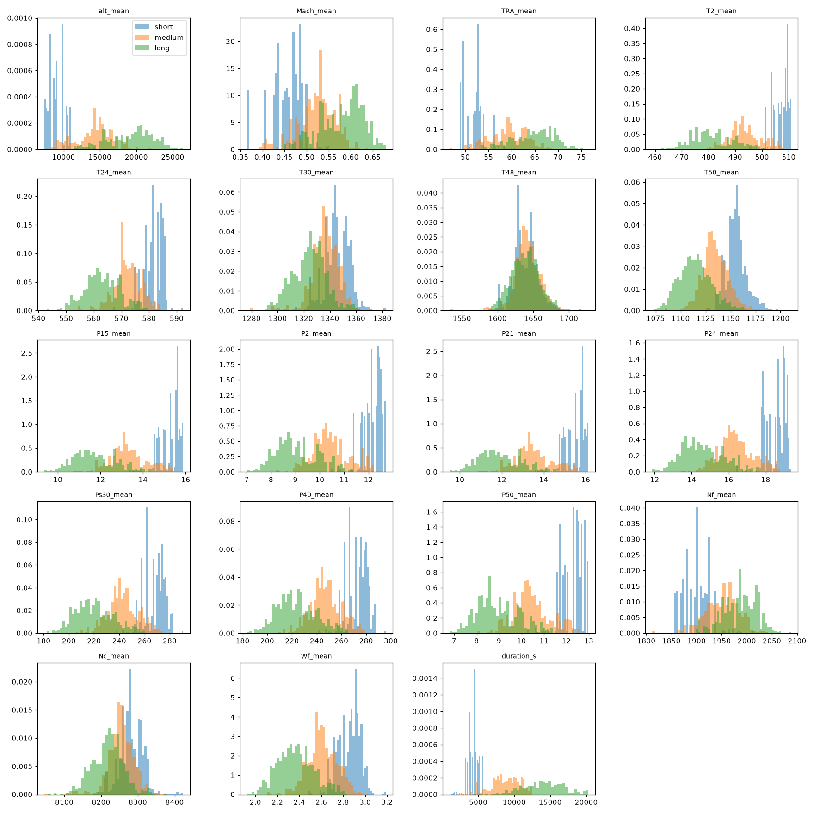
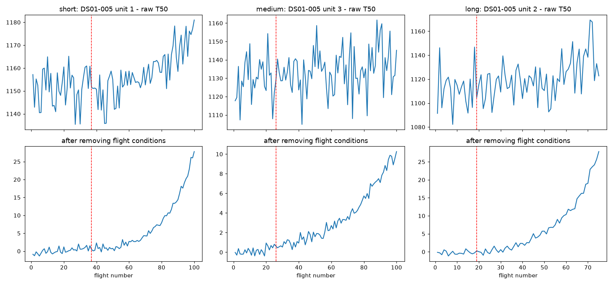
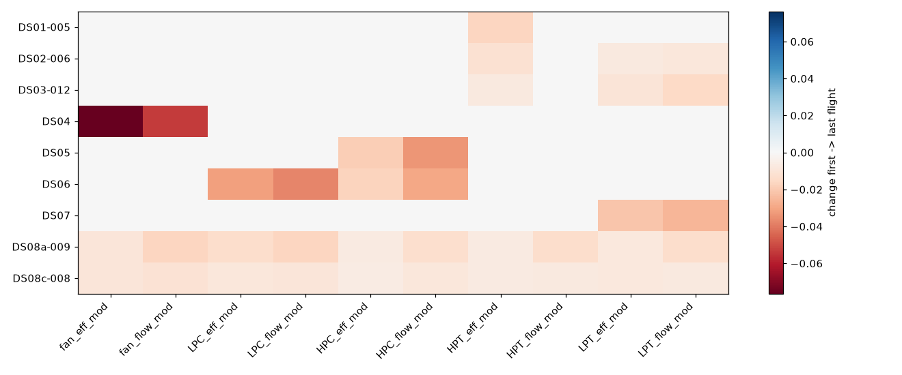
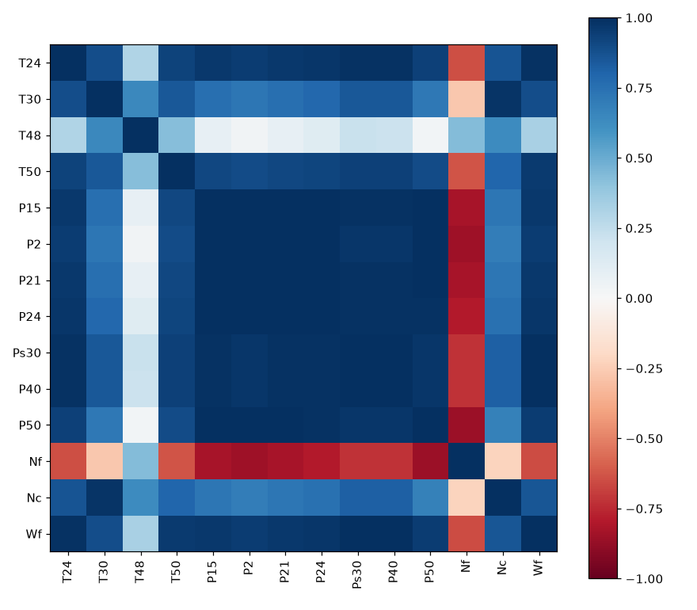

# N-CMAPSS exploratory data analysis

Generated by `experiments/04_deep_statistics.py`. Do not edit by hand.


## 1. Overview


Flights per flight class and split:

```
split    dev  test   All
class                   
short   1235  1081  2316
medium  1414  1022  2436
long    1886   835  2721
All     4535  2938  7473
```

Flight duration in minutes:

```
         mean   std   min     5%    50%    95%    max
class                                                
short    72.0  13.9  16.8   52.0   74.4   94.6   94.6
medium  147.8  32.0  35.4   85.6  150.6  197.9  207.4
long    234.6  46.9  71.8  153.1  235.6  310.4  338.2
```

Average lifetime (flights) per file and class:

```
class      short  medium  long
file                          
DS01-005    91.0    94.0  82.0
DS02-006    76.0    67.0  72.0
DS03-012    84.0    69.0  67.0
DS04         NaN    89.0  82.0
DS05        93.0    77.0  72.0
DS06        90.0    74.0  72.0
DS07        84.0    74.0  85.0
DS08a-009   78.0    64.0  56.0
DS08c-008    NaN    59.0  51.0
```

Kruskal-Wallis test, lifetime differs between classes: H = 22.8, p = 1.1e-05. (p < 0.05 means the difference is unlikely to be chance.)


## 2. Every variable

One row per variable, using the per-flight average. `eta2_class` = share of the variable's variation explained by flight class (0 = classes look the same, 1 = class decides everything).

```
                          mean        std        min         max  eta2_class
group variable                                                              
W     alt           14449.0102  4825.8647  3001.0000  35033.0000      0.7421
      Mach              0.5236     0.0663     0.0003      0.7493      0.5972
      TRA              59.0005     6.4831    23.5545     88.7689      0.6650
      T2              493.3569    12.2063   421.3779    534.3834      0.7552
X_s   T24             571.7993     9.1587   483.3501    637.0923      0.6869
      T30            1334.5980    14.0929  1060.9704   1547.9570      0.3871
      T48            1639.6279    18.5729   916.7060   2006.0652      0.0046
      T50            1134.0246    21.4996   676.9659   1374.8024      0.6007
      P15              13.3535     1.6708     5.8158     20.4506      0.7636
      P2               10.4640     1.4576     4.3725     15.7005      0.7673
      P21              13.5568     1.6963     5.9095     20.7620      0.7636
      P24              16.4127     1.8757     6.8153     26.4531      0.7584
      Ps30            242.5158    23.2079    77.7622    457.3660      0.7214
      P40             246.8518    23.7196    79.4796    463.8314      0.7224
      P50              10.4743     1.5819     4.0979     16.8847      0.7567
      Nf             1947.9676    47.3433  1467.5142   2293.2221      0.5626
      Nc             8249.3754    45.0346  7341.4651   8921.4082      0.3467
      Wf                2.5969     0.2426     0.2871      5.8174      0.6886
X_v   T40            2538.8760    25.8941  1411.4901   3057.1684      0.0049
      P30             258.4835    24.8373    83.1710    485.6873      0.7224
      P45              45.7483     4.3373    14.4414     87.5574      0.7189
      W21            2009.4232   199.5714   958.5405   3057.7619      0.7504
      W22             176.3394    16.3172    68.1852    299.2366      0.7315
      W25             176.3395    16.3172    68.2257    299.2274      0.7315
      W31              20.3388     1.9275     7.5679     34.8550      0.7315
      W32              12.2033     1.1565     4.5407     20.9130      0.7315
      W48             165.3078    15.6587    61.1565    284.5631      0.7311
      W50             175.0065    16.5562    64.9093    301.0144      0.7311
      SmFan            18.6249     0.8878     9.8772     36.0880      0.2235
      SmLPC             8.2507     0.4834     1.9601     27.6869      0.0054
      SmHPC            28.6967     0.8912    20.3608     56.6203      0.1821
      phi              38.0669     0.5092    13.1453     46.7177      0.2430
T     fan_eff_mod      -0.0018     0.0084    -0.2234      0.0000      0.0130
      fan_flow_mod     -0.0018     0.0064    -0.1212      0.0001      0.0114
      LPC_eff_mod      -0.0012     0.0047    -0.1343      0.0001      0.0064
      LPC_flow_mod     -0.0014     0.0055    -0.1552      0.0001      0.0039
      HPC_eff_mod      -0.0013     0.0029    -0.0255      0.0002      0.0046
      HPC_flow_mod     -0.0019     0.0055    -0.0779      0.0001      0.0073
      HPT_eff_mod      -0.0015     0.0026    -0.0188      0.0000      0.0048
      HPT_flow_mod     -0.0006     0.0021    -0.0389      0.0001      0.0004
      LPT_eff_mod      -0.0015     0.0032    -0.0362      0.0001      0.0018
      LPT_flow_mod     -0.0018     0.0037    -0.0390      0.0001      0.0006
```


## 3. Drift proof: training world vs arriving world (dev engines only)

Reference = medium + long-haul dev flights (the first model's training data). Current = short-haul dev flights (the arriving engines). 73 model-input features (18 variables x 4 statistics + duration).

Share of features that drifted:

```
features           73.000
share KS p<0.05     1.000
share PSI>0.2       0.986
```

Top 20 drifted features:

```
            KS_stat  KS_p     PSI  wasserstein_in_std  mean_shift_in_std
feature                                                                 
duration_s    0.970   0.0  12.441               2.097             -2.097
alt_mean      0.936   0.0  12.441               2.159             -2.159
P24_min       0.912   0.0  12.434               2.467              2.467
P15_mean      0.947   0.0  12.434               2.324              2.324
P21_mean      0.947   0.0  12.434               2.324              2.324
P50_mean      0.938   0.0  12.434               2.337              2.337
P24_mean      0.949   0.0  12.434               2.285              2.285
P2_mean       0.938   0.0  12.391               2.356              2.356
T2_mean       0.940   0.0  12.384               2.192              2.192
T2_min        0.901   0.0  12.363               2.295              2.295
P15_min       0.898   0.0  11.638               2.665              2.665
P21_min       0.898   0.0  11.638               2.664              2.664
P40_mean      0.895   0.0  11.383               2.131              2.131
Mach_max      0.884   0.0  11.221               2.453             -2.453
alt_max       0.934   0.0  11.214               2.581             -2.581
alt_std       0.882   0.0  11.206               2.242             -2.240
P50_min       0.905   0.0  11.199               2.844              2.844
Ps30_mean     0.894   0.0  11.173               2.127              2.127
P2_min        0.907   0.0  11.139               2.727              2.727
TRA_mean      0.886   0.0  11.134               2.001             -2.000
```

Control (no-drift check): two random halves of the reference engines. Should be much lower:

```
features           73.000
share KS p<0.05     0.753
share PSI>0.2       0.205
```

Dev vs test within the same class (is the judge set comparable?):

```
        features  share KS p<0.05  share PSI>0.2
short       73.0            0.685          0.000
medium      73.0            0.603          0.000
long        73.0            0.808          0.178
```


## 4. Input distributions by flight class




*Per-flight averages of all 18 inputs and flight duration, by class*


## 5. How strongly do sensors show wear?

Three versions of each sensor's per-flight average:
- **raw**: as measured
- **delta**: minus the engine's own first-5-flights average (its healthy baseline)
- **residual**: minus what a linear 'healthy engine' model predicts from the flight conditions (fit on healthy flights of dev engines only)

`rho_pooled` = Spearman correlation with RUL across all flights of all engines. `rho_within` = the same, computed inside each engine and averaged. `snr` = (change from the first 20% to the last 10% of life) / (flight-to-flight noise in the first 20%), median over engines. Bigger = easier to see wear. W variables are included as a control: they are flight conditions and should show ~no wear.

```
                rho_pooled_raw  rho_pooled_delta  rho_pooled_resid  rho_within_raw  snr_raw  rho_within_resid  snr_resid
group variable                                                                                                          
X_s   T50                -0.14             -0.37             -0.77           -0.40     2.19             -0.84      38.16
      T48                -0.34             -0.32             -0.72           -0.35     1.81             -0.77      16.72
      T24                 0.07             -0.03             -0.41           -0.05     0.45             -0.43       4.69
      Nc                  0.08              0.01              0.21            0.03     0.61              0.26       4.07
      T30                 0.01             -0.08             -0.13           -0.08     0.74             -0.12       3.98
      Wf                  0.05             -0.06             -0.38           -0.07     0.54             -0.40       3.37
      P40                 0.11              0.02              0.24            0.03     0.48              0.25       1.76
      Ps30                0.10              0.01              0.19            0.02     0.47              0.20       1.51
      P24                 0.09             -0.00              0.05           -0.01     0.41              0.01       0.73
      P21                 0.09              0.00              0.09           -0.01     0.42              0.06       0.41
      P15                 0.09              0.00              0.09           -0.01     0.42              0.06       0.41
      P2                  0.09             -0.00              0.04           -0.01     0.36             -0.00       0.39
      Nf                 -0.09              0.00             -0.01           -0.01     0.34              0.00       0.39
W     alt                -0.09              0.00              0.02            0.01     0.40             -0.01       0.38
      Mach               -0.09              0.01             -0.02            0.00     0.32              0.00       0.38
X_s   P50                 0.10              0.00              0.06            0.01     0.41              0.04       0.38
W     T2                  0.09             -0.00              0.07           -0.01     0.36             -0.01       0.30
      TRA                -0.09              0.00             -0.01            0.00     0.31              0.01       0.29
```

Sensor with the clearest wear signal after removing flight conditions: **T50**.



*T50: raw per-flight average (top) vs flight-condition-corrected (bottom). Red line = fault starts*


## 6. True health parameters (T): which part wears out in each file?

Average change of each health parameter from an engine's first flight to its last flight, per file. Parameters that move are the failure mode. 0 = no change.

```
           fan_eff_mod  fan_flow_mod  LPC_eff_mod  LPC_flow_mod  HPC_eff_mod  HPC_flow_mod  HPT_eff_mod  HPT_flow_mod  LPT_eff_mod  LPT_flow_mod
file                                                                                                                                            
DS01-005        0.0000        0.0000       0.0000        0.0000       0.0000        0.0000      -0.0165        0.0000       0.0000        0.0000
DS02-006        0.0000        0.0000       0.0000        0.0000       0.0000        0.0000      -0.0116        0.0000      -0.0077       -0.0085
DS03-012        0.0000        0.0000       0.0000        0.0000       0.0000        0.0000      -0.0075        0.0000      -0.0101       -0.0150
DS04           -0.0764       -0.0534       0.0000        0.0000       0.0000        0.0000       0.0000        0.0000       0.0000        0.0000
DS05            0.0000        0.0000       0.0000        0.0000      -0.0190       -0.0337       0.0000        0.0000       0.0000        0.0000
DS06            0.0000        0.0000      -0.0316       -0.0373      -0.0170       -0.0297       0.0000        0.0000       0.0000        0.0000
DS07            0.0000        0.0000       0.0000        0.0000       0.0000        0.0000       0.0000        0.0000      -0.0209       -0.0254
DS08a-009      -0.0090       -0.0163      -0.0134       -0.0163      -0.0071       -0.0129      -0.0069       -0.0133      -0.0081       -0.0134
DS08c-008      -0.0093       -0.0113      -0.0086       -0.0095      -0.0063       -0.0088      -0.0068       -0.0075      -0.0080       -0.0076
```



*Which health parameters change in each file (= failure mode)*

Initial health differs between engines ('unknown initial wear'):

```
              std across engines at flight 1
fan_eff_mod                          0.00028
fan_flow_mod                         0.00032
LPC_eff_mod                          0.00034
LPC_flow_mod                         0.00031
HPC_eff_mod                          0.00035
HPC_flow_mod                         0.00035
HPT_eff_mod                          0.00035
HPT_flow_mod                         0.00027
LPT_eff_mod                          0.00034
LPT_flow_mod                         0.00036
```


## 7. Sensor redundancy

Pearson correlation between sensors' per-flight averages. Pairs above 0.95 carry almost the same information.

```
               r
P15  P21   1.000
Ps30 P40   1.000
P21  P24   0.999
P15  P24   0.999
     P2    0.999
P2   P21   0.999
     P50   0.997
P15  P50   0.996
P21  P50   0.996
P2   P24   0.995
Ps30 Wf    0.993
P40  Wf    0.992
P24  P40   0.992
     Ps30  0.992
     P50   0.991
P21  P40   0.986
P15  P40   0.986
T24  Wf    0.986
P21  Ps30  0.986
P15  Ps30  0.985
T24  Ps30  0.985
     P40   0.985
T30  Nc    0.984
P2   P40   0.976
     Ps30  0.976
P40  P50   0.974
P24  Wf    0.974
T24  P24   0.973
Ps30 P50   0.973
P21  Wf    0.963
P15  Wf    0.963
T24  P21   0.962
     P15   0.962
T50  Wf    0.955
```



*Correlation between the 14 sensors*


## 8. Oddities worth knowing


Engines whose average flight is less than 60% of their class median:

```
        file split  unit  class  n_flights  avg_flight_min
17  DS02-006  test    14  short         76            34.4
```

Flights shorter than 30% of their class median: 11 of 7473 (0.1%).

```
                      very short flights
file     unit class                     
DS02-006 14   short                    8
         15   medium                   3
```

Input features that never change (useless for the model): none
